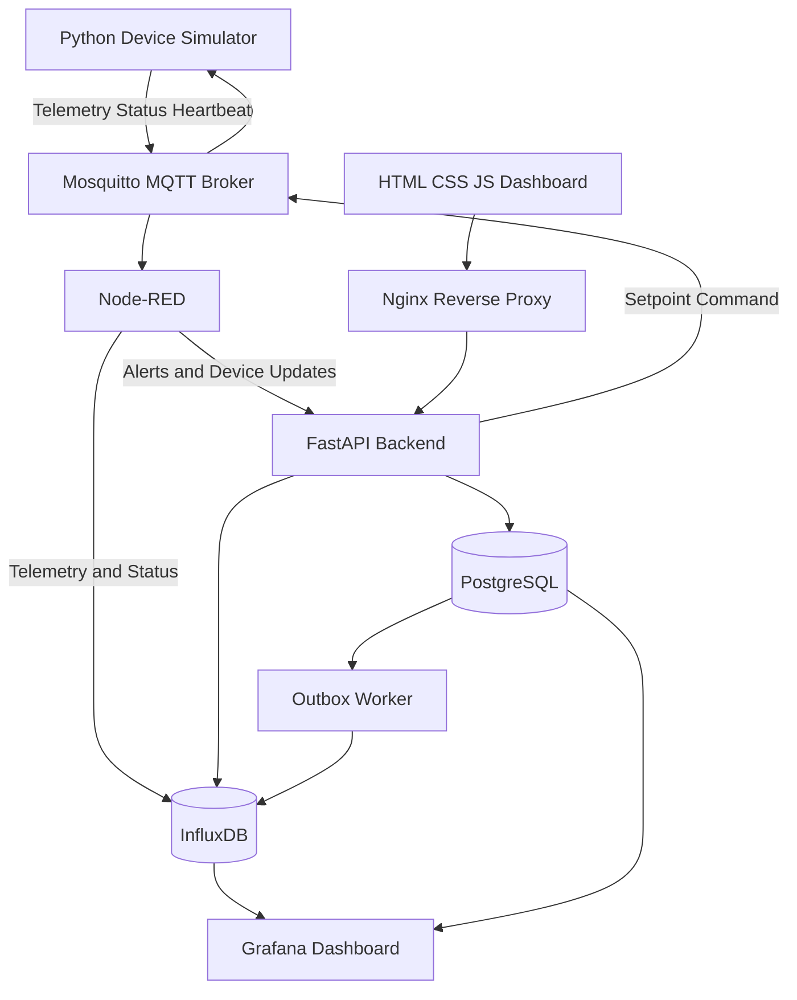
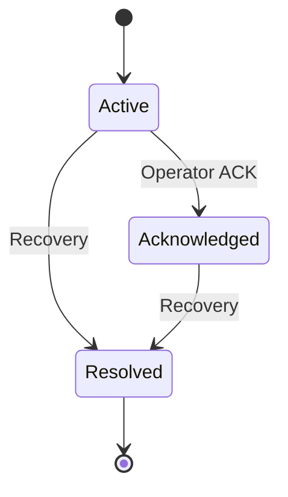

# Cold-Chain IoT Monitoring System — Team 2

Mini IoT Platform Kampus — Final Project IoT
CSEB3073 | AIR24
Domain: Cold-Chain / Smart Storage

## 1. Deskripsi Proyek

Cold-Chain IoT Monitoring System merupakan sistem pemantauan kondisi penyimpanan cold-chain secara real-time.

Sistem memantau suhu, kelembapan, status pintu, baterai, konektivitas perangkat, dan setpoint suhu pada tiga chamber penyimpanan.

Sistem mendukung:

- Real-time telemetry monitoring.
- MQTT communication.
- Device heartbeat, birth message, dan Last Will and Testament (LWT).
- Telemetry dan device status validation.
- Temperature threshold monitoring.
- Alert generation, acknowledgement, escalation, dan recovery.
- Remote setpoint control.
- PostgreSQL alert persistence.
- Transactional outbox untuk sinkronisasi alert ke InfluxDB.
- Grafana observability dashboard.
- Responsive HTML/CSS/JavaScript monitoring dashboard.
- REST API dengan autentikasi X-API-Key.

## 2. Arsitektur Sistem



### Komponen Teknologi

| Komponen | Teknologi | Fungsi |
|---|---|---|
| Device Simulator | Python, Paho MQTT | Simulasi perangkat IoT |
| MQTT Broker | Eclipse Mosquitto 2 | Pertukaran pesan MQTT |
| Data Processing | Node-RED | Validasi data dan rule engine |
| Time-Series Database | InfluxDB 2.7 | Penyimpanan telemetry dan status |
| Relational Database | PostgreSQL 16 | Device registry, alert, dan outbox |
| REST API | FastAPI | Akses data dan kontrol perangkat |
| Observability | Grafana | Visualisasi dan monitoring |
| Web Dashboard | HTML5, CSS3, JavaScript | Monitoring dan kontrol operator |
| Reverse Proxy | Nginx | Penyajian dashboard dan API proxy |
| Deployment | Docker Compose | Orkestrasi layanan |

## 3. Struktur Repository

```text
coldchain-tim2/
├── backend/
│   ├── app/
│   │   ├── routers/
│   │   ├── config.py
│   │   ├── database.py
│   │   ├── influx.py
│   │   ├── main.py
│   │   ├── mqtt.py
│   │   ├── outbox.py
│   │   └── outbox_worker.py
│   ├── Dockerfile
│   └── requirements.txt
├── dashboard/
│   ├── app.js
│   ├── index.html
│   ├── nginx.conf
│   └── style.css
├── grafana/
│   ├── dashboards/
│   └── provisioning/
├── mosquitto/
│   └── config/
├── nodered/
│   └── data/
├── postgres/
│   ├── init/
│   └── migrations/
├── simulator/
│   ├── coldchain_simulator.py
│   └── requirements.txt
├── tests/
├── .env.example
├── .gitignore
├── docker-compose.yml
└── README.md
```

File kredensial dan direktori runtime tidak disertakan dalam repository.

## 4. Device Registry

Seluruh perangkat menggunakan domain `coldchain`.

| Device ID | Gedung | Ruang | Default Setpoint |
|---|---|---|---:|
| cc-01 | bsd-a | gudang-a | 4.5°C |
| cc-02 | bsd-a | gudang-a | 3.8°C |
| cc-03 | bsd-a | gudang-b | 5.2°C |

### Telemetry Metrics

| Metric | Satuan / Tipe |
|---|---|
| temp_c | Celsius |
| humidity_pct | Persen |
| door_open | Boolean |
| battery_pct | Persen |
| rssi_dbm | dBm |
| setpoint_c | Celsius |

Interval telemetry nominal adalah 5 detik.

Interval heartbeat nominal adalah 15 detik.

## 5. MQTT Communication

### Topic Convention

```text
kampus/{domain}/{gedung}/{ruang}/{device_id}/{channel}
```

### Channel

| Channel | Fungsi |
|---|---|
| telemetry | Pengiriman data sensor |
| status | Status online/offline perangkat |
| heartbeat | Indikasi perangkat masih aktif |
| cmd | Pengiriman command ke perangkat |

Contoh topic:

```text
kampus/coldchain/bsd-a/gudang-a/cc-01/telemetry
kampus/coldchain/bsd-a/gudang-a/cc-01/status
kampus/coldchain/bsd-a/gudang-a/cc-01/heartbeat
kampus/coldchain/bsd-a/gudang-a/cc-01/cmd
```

Status perangkat menggunakan retained message, birth message, dan LWT untuk mendukung deteksi perubahan konektivitas.

Telemetry dan status divalidasi sebelum diproses lebih lanjut.

MQTT broker menggunakan autentikasi username/password dan access control list (ACL). Anonymous access tidak diizinkan.

## 6. Persyaratan Sistem

- Windows dengan PowerShell.
- Docker Desktop dan Docker Compose V2.
- Python 3.
- Git.
- Browser modern.
- Koneksi internet untuk mengunduh Docker image dan dependensi pada instalasi awal.

## 7. Instalasi dan Konfigurasi

### 7.1 Clone Repository

```powershell
git clone https://github.com/ericsonmeo/coldchain-tim2.git
cd coldchain-tim2
```

### 7.2 Environment Configuration

```powershell
Copy-Item .env.example .env
notepad .env
```

Isi konfigurasi menggunakan kredensial lokal yang aman.

| Environment Variable | Fungsi |
|---|---|
| INFLUXDB_ADMIN_USER | Username administrator InfluxDB |
| INFLUXDB_ADMIN_PASSWORD | Password administrator InfluxDB |
| INFLUXDB_ORG | Organization InfluxDB |
| INFLUXDB_BUCKET | Bucket penyimpanan data |
| INFLUXDB_ADMIN_TOKEN | Token akses InfluxDB |
| MQTT_HOST | Alamat broker untuk simulator |
| MQTT_PORT | Port broker MQTT |
| MQTT_USERNAME | Username MQTT simulator/backend |
| MQTT_PASSWORD | Password MQTT simulator/backend |
| POSTGRES_USER | Username PostgreSQL |
| POSTGRES_PASSWORD | Password PostgreSQL |
| API_KEY | Secret autentikasi REST API |

Konfigurasi default non-secret:

- InfluxDB organization: `prasmul`
- InfluxDB bucket: `iot`
- PostgreSQL database: `kampus`
- MQTT host untuk simulator: `127.0.0.1`
- MQTT port: `1883`

Jangan menggunakan placeholder kredensial dari `.env.example` sebagai kredensial produksi.

### 7.3 MQTT Credentials

File password Mosquitto tidak disimpan dalam Git.

Sebelum menjalankan sistem pada instalasi baru, buat file password lokal sesuai konfigurasi `mosquitto/config/mosquitto.conf` dan `mosquitto/config/acl`.

Akun yang digunakan:

- `coldchain_user`: simulator dan backend.
- `nodered_user`: Node-RED.

Gunakan password yang kuat dan sesuaikan `MQTT_USERNAME` serta `MQTT_PASSWORD` pada `.env` dengan akun simulator/backend.

Contoh pembuatan file password pada instalasi baru:

```powershell
docker run --rm -it `
    -v "${PWD}/mosquitto/config:/mosquitto/config" `
    eclipse-mosquitto:2 `
    mosquitto_passwd -c /mosquitto/config/passwd coldchain_user
```

Tambahkan akun Node-RED:

```powershell
docker run --rm -it `
    -v "${PWD}/mosquitto/config:/mosquitto/config" `
    eclipse-mosquitto:2 `
    mosquitto_passwd /mosquitto/config/passwd nodered_user
```

Opsi `-c` membuat ulang file password. Jangan menggunakannya pada instalasi yang sudah memiliki akun tanpa melakukan backup.

### 7.4 Jalankan Infrastruktur

```powershell
docker compose up --build -d
docker compose ps
```

Pastikan seluruh tujuh layanan berjalan.

```text
mosquitto
nodered
influxdb
postgres
backend
grafana
dashboard
```

### 7.5 Konfigurasi Node-RED

Buka:

http://localhost:1880

Flow Node-RED tersedia dalam `nodered/data/flows.json`.

Pada instalasi baru:

1. Pastikan dependensi node yang digunakan flow tersedia.
2. Konfigurasi MQTT broker menggunakan hostname `mosquitto`, port `1883`, dan kredensial akun `nodered_user`.
3. Konfigurasi koneksi InfluxDB menggunakan `http://influxdb:8086`, organization, bucket, dan token lokal.
4. Pastikan internal REST API mengarah ke `http://backend:8000`.
5. Pastikan autentikasi internal menggunakan API key dari environment.
6. Deploy flow aktif.
7. Pastikan flow lama yang tidak digunakan tetap disabled agar tidak terjadi pemrosesan ganda.

Kredensial Node-RED harus dikonfigurasi secara lokal karena `flows_cred.json` tidak disimpan dalam repository.

### 7.6 Instal Dependensi Simulator

```powershell
py -m pip install -r simulator/requirements.txt
```

### 7.7 Jalankan Simulator

```powershell
py simulator/coldchain_simulator.py
```

Simulator dijalankan pada terminal terpisah dari Docker Compose.

## 8. Service Access

| Service | Address |
|---|---|
| HTML/CSS Dashboard | http://localhost:8080 |
| Grafana | http://localhost:3000 |
| FastAPI Backend | http://localhost:8000 |
| Swagger API Documentation | http://localhost:8000/docs |
| Node-RED | http://localhost:1880 |
| InfluxDB | http://localhost:8086 |
| PostgreSQL | localhost:5432 |
| MQTT Broker | localhost:1883 |

HTML/CSS Dashboard menggunakan Nginx reverse proxy dan dibatasi pada alamat loopback `127.0.0.1`.

Layanan lainnya menggunakan port mapping sesuai Docker Compose dan harus dijalankan dalam lingkungan pengembangan yang tepercaya.

## 9. Health Check dan REST API

### 9.1 Health Check

Health check tidak memerlukan API key.

```powershell
Invoke-RestMethod http://localhost:8000/health
```

Health check melalui reverse proxy:

```powershell
Invoke-RestMethod http://localhost:8080/health
```

### 9.2 API Authentication

Endpoint data dan command menggunakan header `X-API-Key`.

Contoh mengambil API key secara lokal tanpa menampilkan nilainya:

```powershell
$apiKey = ((Get-Content .env |
    Where-Object { $_ -match '^API_KEY=' } |
    Select-Object -First 1) -split '=', 2)[1].Trim()

$headers = @{ "X-API-Key" = $apiKey }
```

Request tanpa API key atau dengan API key tidak valid akan ditolak dengan HTTP 401.

### 9.3 Device API

| Method | Endpoint | Fungsi |
|---|---|---|
| GET | /api/v1/devices | Daftar perangkat |
| GET | /api/v1/devices/{device_id} | Detail perangkat |
| GET | /api/v1/devices/{device_id}/status | Status perangkat |

### 9.4 Telemetry API

| Method | Endpoint | Fungsi |
|---|---|---|
| GET | /api/v1/telemetry | Riwayat telemetry |
| GET | /api/v1/telemetry/latest | Telemetry terbaru |

Contoh:

```powershell
Invoke-RestMethod `
    -Uri "http://localhost:8000/api/v1/telemetry/latest?domain=coldchain" `
    -Headers $headers
```

Telemetry history mendukung filter domain, device_id, rentang waktu, dan limit.

Limit maksimum adalah 1000 record per request.

### 9.5 Cold-Chain API

| Method | Endpoint | Fungsi |
|---|---|---|
| GET | /api/v1/coldchain/chambers | Daftar chamber dan telemetry terbaru |
| GET | /api/v1/coldchain/chambers/{device_id} | Detail chamber |
| GET | /api/v1/coldchain/escalations | Riwayat escalation |
| POST | /api/v1/coldchain/cmd/{device_id} | Pengiriman setpoint command |

Contoh:

```powershell
Invoke-RestMethod `
    -Uri "http://localhost:8000/api/v1/coldchain/chambers" `
    -Headers $headers
```

### 9.6 Alert API

| Method | Endpoint | Fungsi |
|---|---|---|
| GET | /api/v1/alerts | Daftar alert |
| GET | /api/v1/alerts/{alert_id} | Detail alert |
| POST | /api/v1/alerts/{alert_id}/ack | Acknowledge alert |
| POST | /api/v1/alerts/{alert_id}/resolve | Resolve alert |

Endpoint internal digunakan oleh Node-RED dan backend untuk pemrosesan alert, escalation, recovery, serta pembaruan status perangkat.

Endpoint internal tidak diekspos melalui reverse proxy dashboard.

Gunakan Swagger pada backend langsung untuk melihat schema request dan response aktual.

## 10. Simulator Modes

| Mode / Command | Fungsi |
|---|---|
| NORMAL | Telemetry dalam kondisi normal |
| SPIKE | Simulasi kenaikan suhu |
| DOOR | Simulasi pintu terbuka |
| STOP | Menghentikan telemetry sementara |
| CRASH cc-01 | Memutus koneksi MQTT perangkat cc-01 |
| RECONNECT cc-01 | Menghubungkan kembali perangkat cc-01 |
| STATUS | Menampilkan kondisi simulator |
| HELP | Menampilkan bantuan command |
| EXIT | Menghentikan simulator |

### Perbedaan STOP dan CRASH

STOP menghentikan pengiriman telemetry, tetapi heartbeat tetap berjalan. Sistem dapat mendeteksi kondisi no-data walaupun perangkat masih terhubung.

CRASH memutus koneksi MQTT perangkat sehingga mekanisme LWT dapat menandai perangkat offline.

RECONNECT menghubungkan kembali perangkat dan memulihkan pengiriman data sesuai kondisi simulator.

## 11. Alert Rules

| Alert Type | Kondisi | Durasi | Severity Aktual |
|---|---|---|---|
| TEMP_WARN | Suhu > 6°C | 01:00 | warning |
| TEMP_HIGH | Suhu > 8°C | 02:00 | critical |
| TEMP_ESCALATED | TEMP_HIGH belum di-ACK | 05:00 | critical |
| DOOR_OPEN_LONG | Pintu terbuka | 01:00 | warning |
| OFFLINE | Tidak ada telemetry | 01:00 | critical |
| OFFLINE | Device offline melalui status/LWT | Berdasarkan event | critical |

TEMP_ESCALATED pada implementasi Tim 2 dibedakan melalui `alert_type`, sedangkan nilai severity yang tersimpan adalah `critical`.

Perbedaan representasi severity ini perlu diselaraskan dengan kontrak platform bersama Tim 3.

### Alert Lifecycle



Alert aktif yang belum di-ACK dapat memicu escalation sesuai rule.

Acknowledgement menandai alert telah ditangani operator dan tidak menghapus riwayat alert.

Escalation yang sudah tercatat tetap menjadi bagian dari riwayat sistem.

Rule engine menerapkan deduplication untuk mencegah pembuatan alert aktif berulang dalam kondisi yang sama.

## 12. Remote Setpoint Control

Setpoint dapat dikirim melalui endpoint:

```text
POST /api/v1/coldchain/cmd/{device_id}
```

Contoh request body:

```json
{
  "command": "setpoint",
  "args": {
    "temp_c": 5.0
  }
}
```

Gunakan Swagger untuk memastikan schema request sesuai versi backend yang dijalankan.

Setpoint yang diizinkan berada pada rentang 0–10°C.

Alur pengiriman:

1. Operator memasukkan setpoint baru.
2. Backend melakukan validasi autentikasi, perangkat, status, dan nilai setpoint.
3. Command dikirim melalui MQTT.
4. Simulator menerima command.
5. Telemetry berikutnya membawa setpoint aktual.
6. Dashboard mengonfirmasi penerapan berdasarkan telemetry terbaru.

Keberhasilan HTTP atau MQTT publish tidak otomatis berarti perangkat telah menerapkan command.

Dashboard memiliki confirmation timeout 30 detik dan stale telemetry threshold 60 detik.

## 13. HTML/CSS Dashboard

URL:

http://localhost:8080

Masukkan API key dari file `.env` pada panel API Connection, kemudian klik Connect.

### Fitur Dashboard

- Online chambers KPI.
- Average temperature KPI.
- Active alerts KPI.
- Doors open KPI.
- Chamber detail cards.
- Temperature dan humidity charts.
- Temperature threshold visualization.
- Online/offline device status.
- Alert monitoring dan status filtering.
- Alert acknowledgement.
- Escalation monitoring.
- Remote setpoint control.
- Telemetry-based command confirmation.
- Setpoint confirmation timeout.
- Setpoint draft preservation.
- Stale data protection.
- Automatic refresh dengan interval nominal 5 detik.
- Responsive layout.
- Disconnect dan pending request cancellation.

Dashboard dibangun menggunakan HTML5, CSS3, dan vanilla JavaScript tanpa ketergantungan CDN untuk rendering utama.

API key digunakan selama sesi koneksi dan tidak disimpan secara sengaja dalam localStorage atau sessionStorage.

## 14. Grafana Dashboard

URL:

http://localhost:3000

Grafana menggunakan provisioning datasource dan dashboard yang tersedia dalam repository.

Datasource:

- InfluxDB.
- PostgreSQL.

Dashboard mencakup monitoring:

- Temperature.
- Humidity.
- Door status.
- Device connectivity.
- Alert history.
- Escalation.
- Telemetry message rate.
- Device status timeline.
- Alert backup monitoring.

Dashboard mendukung pemilihan device dan pemantauan ketiga chamber.

File dashboard:

```text
grafana/dashboards/coldchain-dashboard.json
```

Provisioning:

```text
grafana/provisioning/
```

## 15. Database dan Data Persistence

### PostgreSQL

Database: `kampus`

Tabel utama:

- `devices`
- `alert_events`
- `alert_outbox`

Schema awal tersedia dalam:

```text
postgres/init/
```

Migration tambahan tersedia dalam:

```text
postgres/migrations/
```

Script initialization PostgreSQL dijalankan ketika direktori data database masih kosong.

Untuk database lama, migration yang belum diterapkan harus diperiksa dan dijalankan secara terkontrol.

### InfluxDB

Organization: `prasmul`

Bucket: `iot`

Measurement yang digunakan mencakup:

- `telemetry`
- `status`
- `alerts`
- `alert_lifecycle`

### Transactional Outbox

Perubahan lifecycle alert dicatat bersama outbox di PostgreSQL.

Outbox worker melakukan sinkronisasi event ke InfluxDB dengan mekanisme retry.

Event yang didukung:

- CREATED
- ACKNOWLEDGED
- RESOLVED

Mekanisme ini membantu menjaga konsistensi backup alert ketika InfluxDB mengalami gangguan sementara.

Alert historis sebelum implementasi outbox tidak otomatis di-backfill.

## 16. Security

Implementasi keamanan mencakup:

- MQTT username/password authentication.
- MQTT ACL.
- Anonymous MQTT access disabled.
- REST API X-API-Key authentication.
- Telemetry dan status validation.
- Setpoint input validation.
- Pemisahan endpoint internal dari dashboard proxy.
- Pembatasan HTTP method dan API route pada Nginx.
- Content Security Policy.
- X-Content-Type-Options.
- X-Frame-Options.
- Referrer-Policy.
- Cache-Control no-store.
- Pencegahan forwarding cookie melalui dashboard proxy.
- Read-only dashboard container filesystem.
- Read-only dashboard file mounts.
- Reduced Linux capabilities.
- No-new-privileges.
- Pinned Nginx image digest.
- Loopback-only dashboard port binding.

Jangan mengunggah:

- `.env`
- MQTT password file.
- Node-RED credential file.
- Database runtime data.
- Grafana runtime data.
- API key, password, atau token asli.

Sistem ini ditujukan untuk lingkungan praktikum dan demonstrasi lokal.

Deployment produksi memerlukan pengamanan tambahan, termasuk TLS, network isolation, pengelolaan secret, dan pembatasan akses terhadap seluruh layanan.

## 17. Testing

Repository menyediakan pengujian validasi telemetry dan status:

```text
tests/test_telemetry_validation.py
tests/test_status_validation.py
```

Pengujian fungsional dan regression yang telah dilakukan mencakup:

- Normal telemetry.
- Temperature spike.
- Temperature warning dan critical alert.
- Alert escalation.
- ACK dan escalation prevention.
- Door-open alert.
- STOP dan no-data detection.
- CRASH dan LWT.
- RECONNECT dan recovery.
- Setpoint command.
- Telemetry confirmation dan timeout.
- Alert outbox synchronization.
- Dashboard rendering.
- Responsive layout.
- API authentication.
- Reverse proxy restrictions.
- Stale data protection.
- Refresh concurrency dan disconnect handling.

Pengujian dashboard dilakukan melalui browser dan simulasi perangkat lokal.

Hasil pengujian tidak dimaksudkan sebagai sertifikasi keamanan atau jaminan bebas bug.

## 18. Panduan Demonstrasi

| Skenario | Tindakan | Expected Result |
|---|---|---|
| Normal | NORMAL | Tiga chamber online dan telemetry normal |
| Temperature warning | SPIKE selama sekitar 01:00 | TEMP_WARN |
| Temperature critical | SPIKE selama sekitar 02:00 | TEMP_HIGH |
| Escalation | Biarkan TEMP_HIGH tanpa ACK selama 05:00 | TEMP_ESCALATED |
| ACK | Klik ACK pada alert aktif | Status acknowledged |
| Door alert | DOOR selama sekitar 01:00 | DOOR_OPEN_LONG |
| No-data | STOP selama sekitar 01:00 | OFFLINE karena no-data |
| Device crash | CRASH cc-01 | LWT dan status offline |
| Reconnect | RECONNECT cc-01 | Perangkat kembali online |
| Setpoint | Ubah setpoint melalui dashboard | Telemetry menunjukkan setpoint baru |
| Recovery | NORMAL | Alert kondisi abnormal kembali resolved |

Durasi alert merupakan threshold rule. Waktu aktual dapat dipengaruhi interval telemetry, polling, dan pemrosesan.

Untuk escalation, durasi 05:00 dihitung sejak TEMP_HIGH terpicu, bukan sejak awal SPIKE.

Setelah demonstrasi, kembalikan simulator ke NORMAL dan setpoint default.

## 19. Stop, Restart, dan Reset

### Stop Simulator

Masukkan:

```text
EXIT
```

### Stop Infrastructure

```powershell
docker compose stop
```

### Start Kembali

```powershell
docker compose start
```

### Rebuild Backend

```powershell
docker compose up -d --build backend
```

### Remove Containers

```powershell
docker compose down
```

Data pada bind-mounted directories tetap tersimpan.

### Reset Data

PERINGATAN: Reset data bersifat destruktif.

Direktori data yang digunakan:

```text
influxdb/
postgres/data/
grafana/data/
mosquitto/data/
mosquitto/log/
```

Lakukan backup sebelum menghapus direktori runtime yang ingin di-reset.

Hentikan simulator dan Docker Compose terlebih dahulu.

Jangan menghapus direktori konfigurasi, flow Node-RED, dashboard provisioning, atau file source code.

Perintah `docker compose down -v` saja tidak menghapus data yang tersimpan dalam bind-mounted directories tersebut.

Setelah reset, jalankan kembali instalasi dan konfigurasi yang diperlukan.

## 20. Integration Handoff — Team 3

Repository ini merupakan implementasi domain Cold-Chain milik Tim 2.

Komponen yang disiapkan untuk integrasi:

- MQTT topic domain coldchain.
- Tiga perangkat coldchain.
- Telemetry dan device status.
- Alert rules dan lifecycle.
- Cold-chain REST API.
- Remote setpoint command.
- PostgreSQL schema dan migration.
- InfluxDB measurements.
- Node-RED flows.
- Grafana dashboard.
- Domain-specific HTML/CSS dashboard.

Integrasi platform kampus bersama dikoordinasikan oleh Tim 3.

Hal yang perlu diselaraskan:

- Shared Docker Compose.
- Shared MQTT broker dan ACL.
- Shared InfluxDB organization, bucket, dan measurement.
- Shared PostgreSQL schema.
- Shared API authentication.
- Response schema dan timestamp convention.
- Alert severity dan escalation representation.
- Central dashboard.
- Cross-domain device dan alert aggregation.
- Endpoint summary.

Endpoint summary lintas domain belum diimplementasikan dalam repository Tim 2.

Dashboard Tim 2 menggunakan port 8080 untuk deployment mandiri. Penggunaan port yang sama oleh central dashboard perlu diselaraskan saat integrasi.

Perubahan kontrak bersama harus dikoordinasikan antar-tim.

## 21. Project Status

Komponen domain Cold-Chain telah diimplementasikan dan diuji pada lingkungan pengembangan lokal.

Repository ini menyediakan deployment mandiri Tim 2.

Integrasi tiga domain, validasi platform kampus bersama, dan final demonstration dilakukan pada tahap integrasi antar-tim.

## 22. AI Disclosure

Penggunaan AI dalam pengembangan proyek didokumentasikan pada [DISCLOSURE.md](DISCLOSURE.md).

## 23. Repository

https://github.com/ericsonmeo/coldchain-tim2

Team 2 — Cold-Chain / Smart Storage

Final Project IoT — CSEB3073 AIR24
